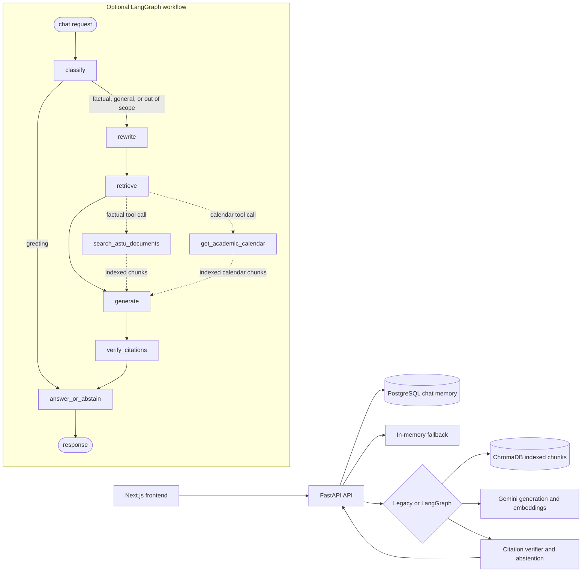

# ASTU CampusGuide AI architecture

The browser talks to a FastAPI backend. The backend keeps the established
retrieval, citation-verification, and abstention behavior, with optional
LangGraph orchestration selected by `USE_GRAPH_PIPELINE=true`. Conversation
turns use PostgreSQL when available and an explicit process-local fallback when
the database is offline; Chroma remains the document retrieval store.

The graph caps tool calls at two per request and falls back to the normal
retrieval function when a function call is malformed or unavailable. Retrieved
text and conversation history remain untrusted data; the existing Gemini
grounding instruction and independent citation verifier remain authoritative.
