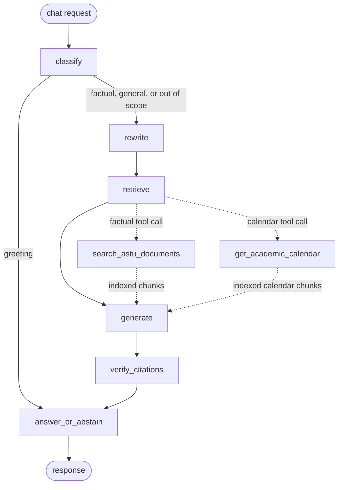

# ASTU CampusGuide AI architecture

The default chat path remains the existing RAG pipeline. Set
`USE_GRAPH_PIPELINE=true` to use the optional LangGraph orchestration; both
paths return the same chat response shape and share retrieval, generation,
citation verification, abstention, and conversation memory services.

The graph caps tool calls at two per request and falls back to the normal
retrieval function when a function call is malformed or unavailable. Retrieved
text and conversation history remain untrusted data; the existing Gemini
grounding instruction and independent citation verifier remain authoritative.
